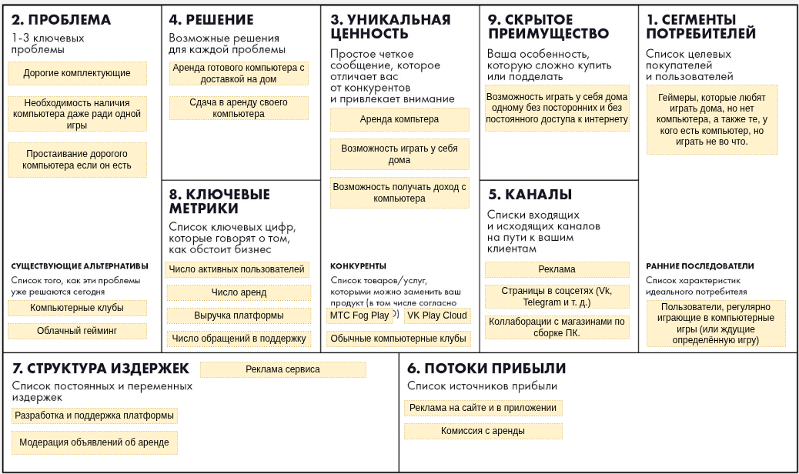

# Домашние задания по курсу "Методы управления разработкой ПО"

## Домашнее задание 1

Бизнес-модель: c2c.

Идея проекта: **PCircle** - сервис для аренды игровых компьютеров.

Главной проблемой при покупке игрового компьютера в 2026 году является постоянное повышение цен на комплектующие. Особенно это коснулось видеокарт и оперативной памяти. Также при покупке дорогого компьютера может возникнуть проблема, что количество игр, в которое хочется поиграть, ограничено, и тогда после их прохождения он будет простаивать. На данный момент существуют 2 основных способа решения этой проблемы - компьютерные клубы и облачный гейминг. Проблема компьютерных клубов заключается в наличии вокруг посторонних людей, которые могут отвлечь в самый ответственный момент, а главный недостаток облачного гейминга - необходимость стабильного интернет-соединения, и даже в этом случае будут просадки частоты кадров в сравнении с игрой непосредственно на компьютере. Сервис PCircle призвани решить эту проблему. Его идея заключается в том, что при необходимости компьютера можно на время арендовать его у другого человека, после чего этот компьютер доставят вам и вы можете некоторое время проходить на нём любимые игры. Это позволит арендатору играть дома на реальной машине без наличия посторонних людей в комнате и ровно столько, сколько нужно. Арендодателям, в свою очередь, это позволит получать прибыль с компьютера на то время, когда он не нужен.

## Домашнее задание 2

### HADI-гипотеза

* H: Люди готовы арендовать компьютер с доставкой на дом, если у них нет денег на сборку своего.
* A: Создание группы в соцсети (например, в VK), где самому сдавать компьютеры в аренду и самому их доставлять.
* D: Замер количества заявок на аренду компьютеров, а также количества успешных заявок.
* I: Если хотя бы 15% заявок будут приводить к успешной аренде, то можно запускать сервис.

### Юнит-экономика

**Подсчёт CAC**

* Клик в рекламе - 25 рублей.
* Конверсия в установку - 20% (125 рублей).
* Конверсия в регистрацию - 25% (500 рублей).
* Конверсия в хотя бы 1 аренду - 50% (1000 рублей)

**Подсчёт LTV**

* Средняя цена аренды в день: 1500 рублей.
* Среднее число дней за аренду: 3 (4500 рублей).
* Комиссия сервиса: 20% (900 рублей).
* Среднее число аренд пользователем: 3 (2700 рублей).

**Соотношение LTV и CAC**

LTV/CAC = 2700 / 1000 = 2.7 - значение меньше 3, есть риск проблем с ростом сервиса.

### Pivot

В качестве резервного плана можно рассмотреть добавление b2b2c - возможность быть арендодателем для компаний. Это может повысить доверие клиентов к арендодателям, чо повысит число аренд одним пользователем, тем самым увеличив LTV.

## Домашнее задание 3

### Роли

Основных ролей 2:
* Арендодатель.
* Арендатор.

Также отдельно выделю роль Пользователь, которая будет включать в себя функциональность, которая должна быть и у арендодателя, и у арендатора.

### User Stories

1. Как пользователь, я хочу максимально подробно заполнить профиль, чтобы другие люди мне больше доверяли.
2. Как арендатор, я хочу просматривать каталог доступных компьютеров с характеристиками и фотографиями, чтобы выбрать такое устройство, которое потянет мою любимую игру.
3. Как арендатор, я хочу применять фильтры к поиску по цене аренды, производительности и доступным датам аренды, чтобы быстрее находить подходящий вариант.
4. Как арендатор, я хочу забронировать компьютер на нужный срок, чтобы вовремя его получить.
5. Как арендатор, я хочу заранее видеть полную стоимость аренды, доставки и дополнительных услуг, чтобы видеть полную стоимость до оформления заказа.
6. Как арендатор, я хочу оплачивать аренду через сервис, чтобы не передавать деньги напрямую незнакомому человеку и иметь подтверждение платежа.
7. Как арендатор, я хочу указать адрес и удобное время доставки, чтобы мне его доставили сразу домой.
8. Как арендатор, я хочу получать уведомления о статусе доставки, чтобы понимать, когда приедет компьютер.
9. Как арендатор, я хочу заказать обратную доставку после окончания аренды, чтобы вернуть компьютер без лишних действий с моей стороны.
10. Как арендодатель, я хочу разместить объявление с характеристиками, фотографиями, ценой и условиями аренды, чтобы другие пользователи могли арендовать мой компьютер.
11. Как арендодатель, я хочу подтверждать или отклонять запросы и управлять доступными данными, чтобы контролировать использование моего компьютера.
12. Как арендодатель, я хочу получать залог, чтобы в случае повреждения или хищения моего компьютера я мог получить какую-то компенсацию.
13. Как пользователь, я хочу видеть и оставлять отзывы о компьютере и о пользователях, чтобы повышать прозрачность и доверие между пользователями.
14. Как арендодатель, я хочу иметь возможность фиксировать состояние компьютера при передаче и возврате, чтобы иметь доказательства на случай повреждения и других ситуациях.
15. Как пользователь, я хочу иметь мобильные версии приложения, чтобы иметь более удобный доступ к сервису.

### Приоритезация по MoSCoW

* M: 2, 4, 5, 6, 7, 9, 10, 11, 12, 14.
* S: 1, 3, 13.
* C: 8.
* W: 15.

### MVP и MLP

* MVP: 2, 4, 5, 6, 7, 9, 10, 11, 12, 14.
* MLP: 1, 3, 8, 13, 15.

### Детализация требований

**Для user story 4 (Как арендатор, я хочу забронировать компьютер на нужный срок, чтобы вовремя его получить):**

Функциональные требования:

* Система должна позволять арендатору выбрать дату и время аренды.
* Система должна проверять доступность компьютера на выбранный период и запрещать бронирование, если компьютер недоступен.
* Система должна позволить арендатору отправить запрос на бронирование.
* Система должна хранить информацию о бронировании.
* Система должна отображать статус бронирования: забронировано, подтверждено, оплачено, в процессе, завершено, отказано.

Нефункциональные требования: 

* Проверка доступности бронирования должна осуществляться не более чем за 3 секунды.
* Требуется графический интерфейс, позволяющий выполнить бронирование компьютера.
* Интерфейс должен быть интуитивно понятен.
* Функциональность бронирования должна быть доступна всегда, кроме заранее согласованных периодах обслуживания сервиса.

**Для user story 11 (Как арендодатель, я хочу подтверждать или отклонять запросы и управлять доступными данными, чтобы контролировать использование моего компьютера):**

Функциональные требования:

* Система должна предоставлять арендодателю список заявок на бронирование принадлежащих ему компьютеров.
* Система должна позволять просматривать информацию о арендаторе, отправившем заявку.
* Система должна проверять возможность подтверждения заявки на бронирование на определённый период и не давать возможность подтвердить заявку, если компьютер недоступен.
* Система должна давать возможность подтверждать заявку на бронирование.
* Система должна давать возможность отклонять заявку на бронирование с указанием причин.

Нефункциональные требования: 

* Загрузка списка заявок на бронирование должна осуществляться не более чем за 3 секунды.
* Требуется графический интерфейс, позволяющий управлять заявками на бронирование компьютеров.
* Интерфейс должен быть интуитивно понятен.
* Функциональность бронирования должна быть доступна всегда, кроме заранее согласованных периодах обслуживания сервиса.
